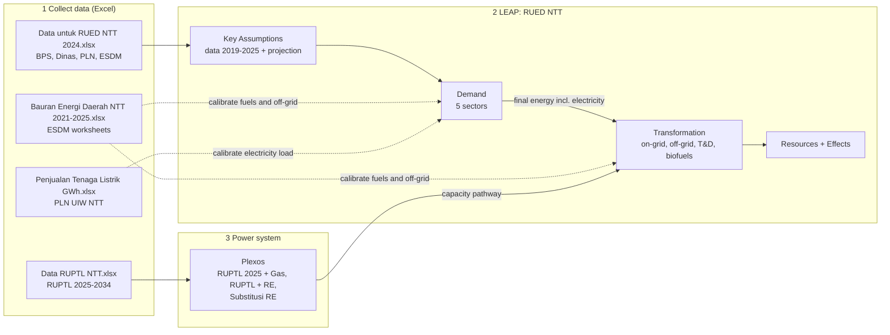

# RUED NTT LEAP Model

LEAP energy model behind the **Rencana Umum Energi Daerah (RUED) of Nusa Tenggara Timur (NTT)**, built to project final energy demand, power generation and emissions of the province.

This repository is written for **the next modeller**: everything needed to understand, update and re-run the model is here: the `.leap` file, the raw data workbooks (split into small CSV files), the logic that connects them and a record of how each number travels from a data source to a result.

| | |
|---|---|
| LEAP area | `RUED NTT 2027-2038 Agustus 2026` (file in [`model/`](model/)) |
| Region | Single region, NTT province (`Region 1`) |
| Calibration (Current Accounts) | 2019 – 2025 actual data |
| Projection | 2026 – 2038 (reported horizon of the RUED) |
| Scenarios | Current Accounts, **BaU** (Baseline), **Moderate**, **Optimis**, plus 25 building-block scenarios |
| Size | 388 Key Assumptions · 756 Demand branches (5 sectors) · 177 Transformation branches · 35 Resources · 1,402 branches in total |
| Language of branch names | Bahasa Indonesia (see the [glossary](docs/glossary.md)) |

## The story in one picture



* **Demand side** (households, transport, commercial, industry, other) is driven by the Key Assumptions 2019–2025 data and gives the final energy per fuel, *including electricity*.
* **On-grid power** still uses the **RUPTL** as the load basis for **Plexos**. Three Plexos runs give the capacity pathway that LEAP reads as *Exogenous Capacity*:
  **BaU = RUPTL + Gas**, **Moderate = RUPTL + RE**, **Optimis = Substitusi RE**, all on the **existing NTT grid**.
* **Off-grid and total primary energy** are calibrated with the **Bauran Energi Daerah worksheets 2021–2025** (ESDM template for NTT, compiled in `data/calibration/`). **Electricity load** is calibrated with **Penjualan Tenaga Listrik (GWh)** (PLN UIW NTT).
* Because Plexos was run on the RUPTL demand, **LEAP demand and Plexos generation (incl. losses) do not match yet**. This is the main open item; see [docs/power-plexos.md](docs/power-plexos.md) for how to close the gap using the LEAP demand projection.

## Start here

| If you want to… | Read |
|---|---|
| Understand the model in 10 minutes | [docs/overview.md](docs/overview.md) |
| See how data moves from source to result | [docs/dataflow.md](docs/dataflow.md) |
| Work on one sector | [Key Assumptions](docs/structure/key-assumptions.md) · [Households](docs/structure/demand-rumah-tangga.md) · [Transport](docs/structure/demand-transportasi.md) · [Commercial](docs/structure/demand-komersial.md) · [Industry](docs/structure/demand-industri.md) · [Other](docs/structure/demand-lainnya.md) · [Transformation](docs/structure/transformation.md) · [Resources, Effects, Indicators](docs/structure/resources-effects.md) |
| Understand BaU / Moderate / Optimis and the 25 building blocks | [docs/scenarios.md](docs/scenarios.md) |
| Connect Plexos (RUPTL) with LEAP | [docs/power-plexos.md](docs/power-plexos.md) |
| Know what is calibrated against what | [docs/calibration.md](docs/calibration.md) |
| Update the data for the next year | [docs/data-update.md](docs/data-update.md) |
| Trace a value, add a branch, refresh the exports | [docs/how-to.md](docs/how-to.md) |
| Things that look wrong and should be checked | [docs/known-issues.md](docs/known-issues.md) |
| Use the RE potential map filters and estimate un-electrified areas | [docs/re-potential-map.md](docs/re-potential-map.md) |
| Look up a term or acronym | [docs/glossary.md](docs/glossary.md) |
| Know what every data file is | [data/README.md](data/README.md) |

Full table of contents: [docs/README.md](docs/README.md).

## Repository layout

| Folder | Content |
|---|---|
| [`model/`](model/) | The LEAP archive `RUED NTT 2027-2038 Agustus 2026.leap` (54 MB, Git LFS) |
| [`data/inputs/`](data/inputs/) | Raw collected data (BPS, Dinas, PLN …), one CSV per sheet of *Data untuk RUED NTT 2024.xlsx* |
| [`data/keyassumptions/`](data/keyassumptions/) | Key Assumptions as yearly values 2019–2050 exported from LEAP |
| [`data/calibration/`](data/calibration/) | Bauran Energi Daerah NTT 2021–2025 (ESDM calibration, compiled) and PLN electricity sales (PLN UIW NTT) |
| [`data/power/`](data/power/) | `ruptl/` (RUPTL tables), `plexos/` (3 Plexos pathways + existing NTT plants), `load_shapes/` (load, wind, solar, lifecycle profiles) |
| [`data/structure/`](data/structure/) | Every branch and every expression exported from LEAP (generated) |
| [`data/dataflow/`](data/dataflow/) | Every branch-to-branch link found in the expressions (generated) |
| [`data/results/`](data/results/) | LEAP results used for the RUED report tables and figures, RUEN comparison |
| [`data/original/`](data/original/) | The original Excel workbooks (Git LFS) for formulas and formatting |
| [`docs/`](docs/) | Documentation |
| [`scripts/`](scripts/) | `export_structure.py`, `build_flow_tables.py`, `split_workbooks.py`, `compile_bauran_energi.py`, `grid_gap_analysis.py` |

## Typical workflow

```
1. Update data     add the new year (2026) to the Excel data  →  Key Assumptions in LEAP (docs/data-update.md)
2. Power system    update Plexos with the new RUPTL / demand   →  paste capacities into Transformation (docs/power-plexos.md)
3. Calibrate       compare with the Bauran Energi Daerah data and PLN sales (docs/calibration.md)
4. Run & export    run the scenarios, Analysis > Export to Excel (All Data)
5. Refresh files   python scripts/export_structure.py
                   python scripts/build_flow_tables.py
                   python scripts/split_workbooks.py
6. Review & commit git diff data/structure data/dataflow ; update docs if the structure changed
```

Large binaries (`.leap`, `.xlsx`) are stored with Git LFS: run `git lfs install` before cloning.

## Requirements

LEAP (the area has *Energy System Optimization* switched off, so capacities are exogenous) · Python 3.10+ with `pandas` and `openpyxl` for the scripts · Plexos only if you re-run the power system.
