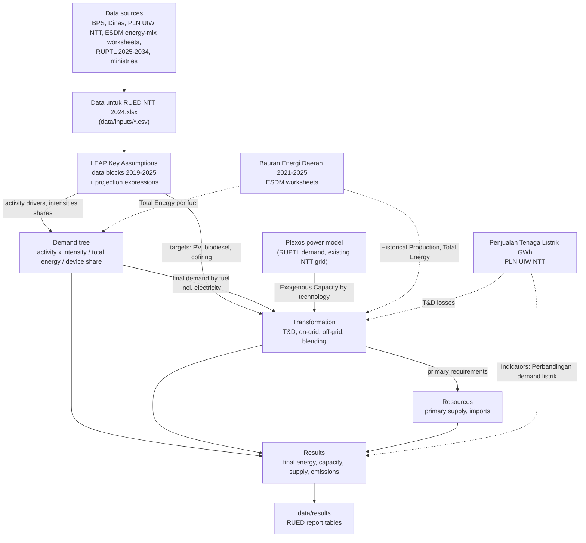
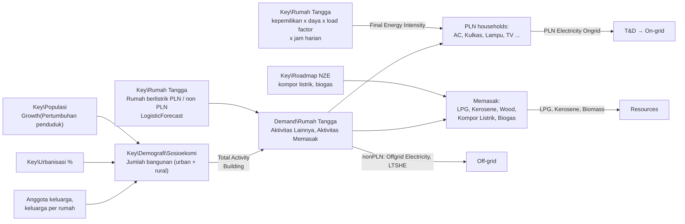
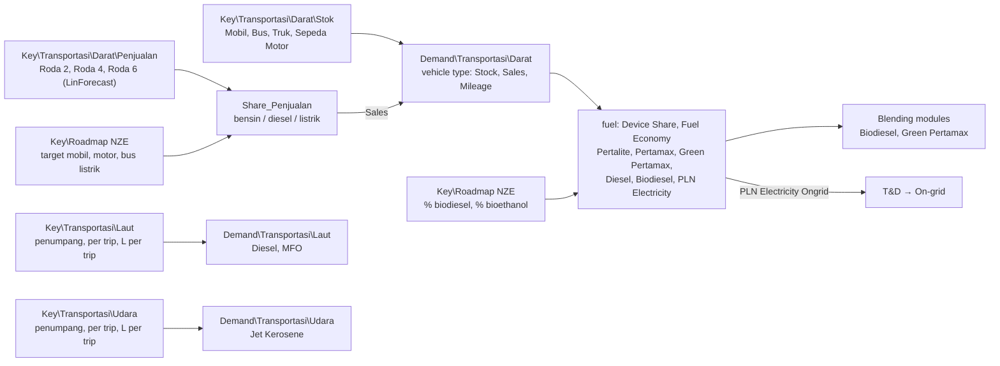
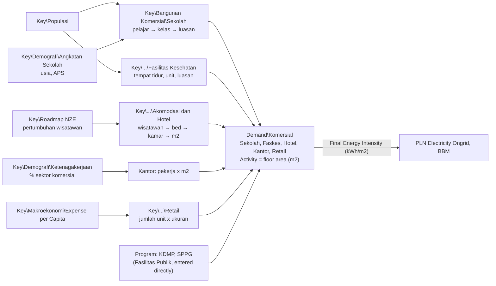
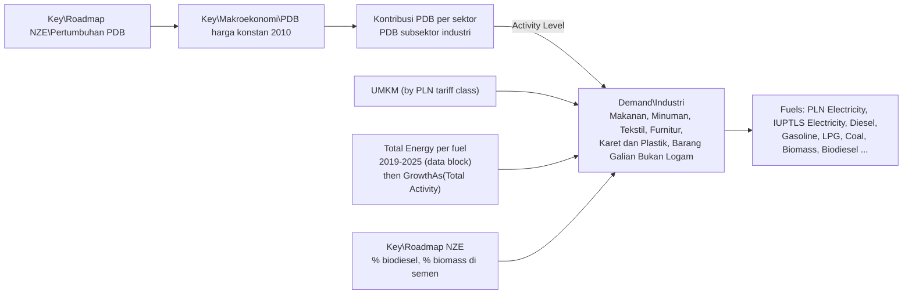
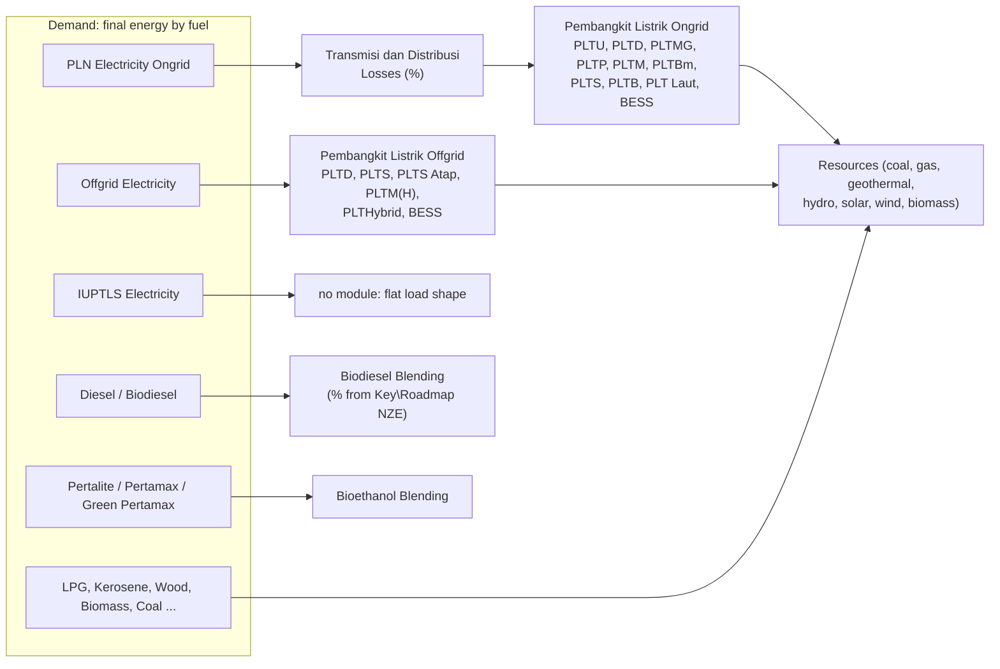
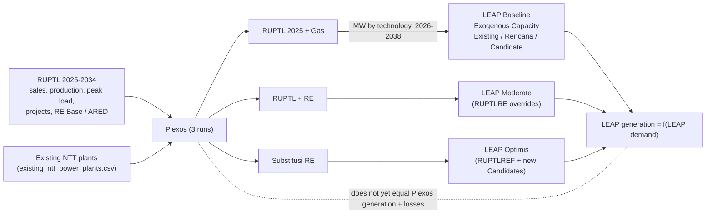

# Dataflow

How a number travels from a data source to a result, and which part of the model reads which. Link counts come from [`data/dataflow/sector_links.csv`](../data/dataflow/sector_links.csv) (Baseline); every individual link is in [`branch_links.csv`](../data/dataflow/branch_links.csv) and the grouped views are in [`key_to_demand_by_source.csv`](../data/dataflow/key_to_demand_by_source.csv) and [`transformation_inputs.csv`](../data/dataflow/transformation_inputs.csv).

## 1. End to end

Solid lines are calculations inside LEAP or data entered into LEAP. Dotted lines are **calibration** or **comparison** links (see [calibration.md](calibration.md)).

## 2. Calculation order inside LEAP

For each year and scenario LEAP:

1. Evaluates the **Key Assumptions** expressions (population → households, GDP → sector value added, vehicle sales …).
2. Evaluates **Demand** from the leaves up: Total Activity of a branch is the product of the activity levels on its path; energy = activity × Final Energy Intensity (or the Total Energy entered directly; or stock × mileage ÷ fuel economy for vehicles). The sum by fuel is the final demand.
3. Runs **Transformation** top to bottom. T&D adds losses to the electricity requirement; the on-grid module meets the requirement with its processes (*FullCapacity* or *PercentShare* dispatch, see [transformation.md](structure/transformation.md)); the off-grid module meets `Offgrid Electricity`; blending modules meet biodiesel / green pertamax.
4. Passes the fuel requirements of the processes to **Resources** (primary supply and imports).
5. Applies the emission factors (**Effects**) to fuel use in Demand and Transformation, and evaluates the **Indicators**.

## 3. Who reads whom

Number of references between trees in the Baseline expressions (from `sector_links.csv`).

| Reading tree / sector | Reads from | Links | Reading branches |
|---|---|---:|---:|
| Demand \ Komersial | Key \ Bangunan Komersial | 54 | 18 |
| Demand \ Komersial | Key \ Demografi | 8 | 2 |
| Demand \ Komersial | Key \ Populasi | 4 | 4 |
| Demand \ Rumah Tangga | Key \ Rumah Tangga | 30 | 9 |
| Demand \ Rumah Tangga | Key \ Roadmap NZE (biogas, electric stove) | 2 | 2 |
| Demand \ Rumah Tangga | Key \ Demografi (buildings) | 1 | 1 |
| Demand \ Transportasi | Key \ Transportasi | 21 | 12 |
| Demand \ Transportasi | Key \ Roadmap NZE (EV, biofuel) | 8 | 8 |
| Demand \ Industri | Key \ Roadmap NZE (biodiesel, biomass in cement) | 14 | 14 |
| Demand \ Industri | Key \ Makroekonomi (GDP of industry sub-sectors) | 5 | 5 |
| Demand \ Lainnya | Key \ Demografi, Key \ Transportasi | 2 | 2 |
| Transformation \ Ongrid | Key \ Roadmap NZE (rooftop PV, cofiring, biodiesel) · Resources \ Secondary (fuel cost) | 5 + 4 | 5 + 4 |
| Transformation \ Offgrid | Key \ Roadmap NZE (off-grid PV, biodiesel) | 5 | 5 |
| Transformation \ Biodiesel / Bioethanol blending | Key \ Roadmap NZE | 1 + 1 | 1 + 1 |
| Key \ Bangunan Komersial | Key \ Bangunan Komersial (internal) · Demografi · Populasi | 67 · 10 · 5 | 21 · 5 · 5 |
| Key \ Demografi | Key \ Demografi (internal) · Populasi · Urbanisasi | 92 · 12 · 2 | 37 · 12 · 2 |
| Key \ Makroekonomi | Key \ Roadmap NZE (GDP growth) · Populasi · Makroekonomi | 1 each | 1 each |
| Key \ Transportasi | Key \ Roadmap NZE (EV share) · Transportasi | 3 + 3 | 3 + 3 |
| Indicators | Demand, Key (Populasi, Makroekonomi) | – | see CSV |

Two things to notice:

* **Roadmap NZE is the policy hub.** The 24 branches under `Key\Roadmap NZE` (EV sales, electric stoves, biogas, biodiesel and bioethanol blend, biomass share in cement, rooftop PV, PLTU cancellation …) are what the building-block scenarios change. They feed Demand, Transformation and Key.
* **Demand → Key feedback**: `Key\Roadmap NZE\...\Target pengguna kompor listrik` reads `Demand\Rumah Tangga\Aktivitas Memasak:Total Activity`, and `Key\Rumah Tangga\Rumah dengan Daya Besar\...` reads the electric-stove share of Demand. These are resolved inside the year calculation.

## 4. Sector flows (Key assumption → Demand → fuel)

Each block shows the chain as written in the expressions. Detailed branch lists are in the sector pages.

### 4.1 Rumah Tangga (households)

### 4.2 Transportasi

### 4.3 Komersial

### 4.4 Industri

### 4.5 Lainnya

`Lainnya` collects the sectors that do not fit the others and many *programme-driven* loads: Akses Air (PDAM, SWPS), Chest Freezer, Cold Storage PPI, Industri Garam, Konstruksi dan Event, Penerangan (PJUTS, PJU PLN), Perikanan, Pertambangan (Smelter Ferromangan), Pertanian, Tambak Udang. Activity is mostly entered as `Interp(...)` of units and the intensity as kW × 8,766 h. Only Perikanan (`Key\Transportasi\Laut\Rasio kepemilikan perahu motor nelayan`) and one building count (`Key\Demografi\Sosioekomi\Jumlah bangunan_total`) read from Key.

## 5. Demand to Transformation

## 6. Calibration flow

| What is calibrated | Against | Where it enters LEAP | Years |
|---|---|---|---|
| Overall energy consumption and **primary energy** per fuel (BBM, coal, EBT, biomass, biogas) | **Bauran Energi Daerah worksheets** (ESDM template, NTT 2021–2025): BBM in kL → BOE, coal, gas, EBT | Demand data blocks (`Total Energy`, `Interp` / `Step` series) in Current Accounts; checked against Resources primary supply | 2021–2025 |
| **Off-grid** (and on-grid) generation by technology | Bauran Energi Daerah, electricity part (installed MW on/off-grid, generation GWh) | `Exogenous Capacity` and `Historical Production` of each process in Current Accounts; Offgrid capacities | 2021–2025 |
| Electricity load | **Penjualan Tenaga Listrik GWh** (PLN UIW NTT; RUPTL C12.1/C12.6) | Indicators `Perbandingan demand listrik` (RUED vs PLN by customer group); T&D `Losses` | 2015–2034 |
| Load shape | RUPTL / PLN hourly load (`Kurva_Beban_NTT`) | `Load Shapes` branches | typical year |

See [calibration.md](calibration.md) for the step-by-step check.

## 7. Power system flow (Plexos ↔ LEAP)

Details and the procedure to close the gap: [power-plexos.md](power-plexos.md).
