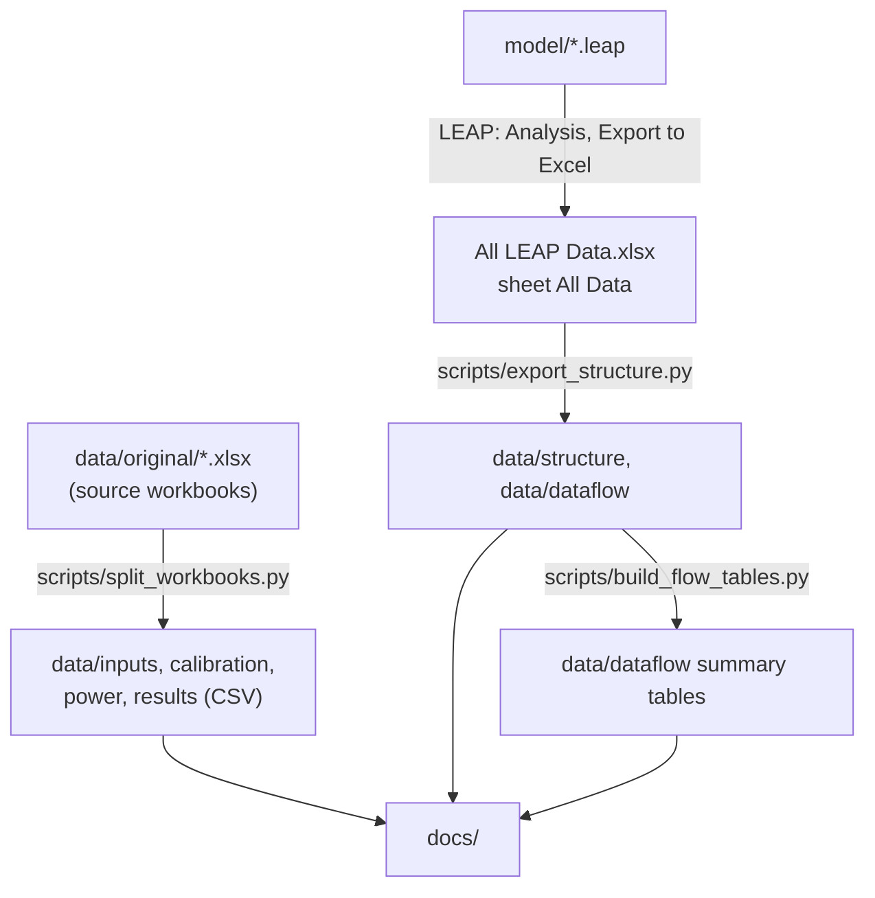

# Overview

## What the model is

A single-region **LEAP** model of Nusa Tenggara Timur (NTT). It calculates final energy demand bottom-up (activity × intensity, or total energy per fuel), converts it through the Transformation modules (power, biofuel blending, biogas, pellets, charcoal, RDF) and reports primary supply, capacity, emissions and indicators for the RUED.

Years: **2019 – 2025** are actual/calibrated data (Current Accounts); **2026 – 2038** are projected by the scenarios. The Area name says `2027-2038` because the RUED planning period starts in 2027; the report tables run 2019–2038.

## The trees

| LEAP tree | What is in it | Branches | Documented in |
|---|---|---:|---|
| **Key Assumptions** | Population, demography, macro-economy, household data, transport stock and sales, commercial-building drivers, and the *Roadmap NZE* policy targets | 388 | [key-assumptions.md](structure/key-assumptions.md) |
| **Demand** | Rumah Tangga, Transportasi, Komersial, Industri, Lainnya | 756 | [sector pages](README.md#table-of-contents) |
| **Transformation** | Ongrid power (127), Offgrid power (27), T&D (2), Biodiesel / Bioethanol blending, Biogas, Biomass pellet, Charcoal, RDF | 177 | [transformation.md](structure/transformation.md) |
| **Resources** | Primary (15) and Secondary (20) fuels | 35 | [resources-effects.md](structure/resources-effects.md) |
| **Effects** | Carbon Dioxide (emission factors sit on the demand and transformation branches) | 1 | [resources-effects.md](structure/resources-effects.md) |
| **Indicators** | Emissions, final energy, primary energy, per-capita figures, and *Perbandingan demand listrik* (RUED vs PLN sales) | 35 | [resources-effects.md](structure/resources-effects.md) |
| **Load Shapes** | `PLN Electricity Ongrid`, `Offgrid Electricity` (both `Kurva_Beban_NTT`), `IUPTLS Electricity` (flat) | 3 | [transformation.md](structure/transformation.md#load-shapes) |

Counts come from [`data/structure/branch_index.csv`](../data/structure/branch_index.csv).

## Scenarios in one table

| Abbrev. | Name | Role | Power pathway (Plexos) |
|---|---|---|---|
| CA | Current Accounts | calibration 2019–2025 | historical capacity and production |
| **BAU** | Baseline | **BaU** | **RUPTL 2025 + Gas** |
| **MOD** | Moderate | **Moderat** | **RUPTL + RE** |
| **OPT** | Optimis | **Optimis** | **Substitusi RE** |

MOD and OPT inherit from BAU and add *building-block* scenarios (electrification ratio, EV, LPG conversion, biodiesel, rooftop PV …). Details: [scenarios.md](scenarios.md).

## How the files in this repository relate

## Conventions

* **Names are Indonesian**: `Rumah Tangga` (household), `Komersial`, `Industri`, `Lainnya` (other), `Pembangkit Listrik Ongrid` (on-grid power plants). Acronyms are in the [glossary](glossary.md).
* **Process naming in power**: `<Technology> Existing` (operating plants), `<Technology> Rencana` (planned in the RUPTL), `<Technology> Candidate` (additional capacity from Plexos beyond the RUPTL).
* **Expressions**: a number like `Interp(2019; 4.22; 2020; 4.23)` is a *data block*: the historical series typed into the Key Assumption. A path like `Key\Populasi[Thousand Penduduk]` is a *reference* to another branch. Both are visible in [`variables_baseline.csv`](../data/structure/variables_baseline.csv).
* **Separator**: LEAP expressions in this area use `;` between arguments.
* **Electricity fuels**: `PLN Electricity Ongrid` (grid), `Offgrid Electricity` (isolated systems, PLN and community), `IUPTLS Electricity` (private licensed utilities).
