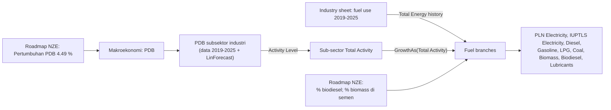

# Demand: Industri

431 branches, mostly emission factors. Seven groups: `Makanan`, `Minuman`, `Tekstil`, `Furnitur`, `Karet dan Plastik`, `Barang Galian Bukan Logam` (cement, non-metal minerals), `UMKM`, plus an empty `Alat Angkut`.

## Method: *Total Energy* per fuel

Unlike households and transport, each fuel branch carries **Total Energy** directly (not activity × intensity):

* **History 2019–2025**: a data block per fuel (`Interp(2019; …)`), from the survey of industrial fuel use in sheet `Industry` of *Data untuk RUED NTT 2024.xlsx* (electricity generated / purchased, petrol, diesel, industrial diesel, biosolar, coal, biomass, briquettes, LPG …).
* **Projection**: `GrowthAs(<sub-sector>:Total Activity; 1)`, i.e. the fuel grows with the sub-sector activity.
* **Sub-sector activity** = value added from `Key\Makroekonomi\Kontribusi PDB per sektor\PDB subsektor industri\*` (Barang Galian Bukan Logam, Furnitur, Karet dan Plastik, Minuman, Tekstil), or `Growth(3%)` for `Makanan`.

## UMKM

Small industry by PLN tariff class (`Industri 450 VA` … `14 sd 200 kVA`): `Activity Level` is the share of customers by class (450 VA is the `Remainder`), `Final Energy Intensity` is kWh per customer per year; the number of UMKM is `LinForecastCA(2020; 219; 2021; 254; …)`.

## Cement (Barang Galian Bukan Logam)

`Coal` and `Biomass` split the thermal energy: `Biomass` = `Target persentase biomass pada industri semen` × total, `Coal` = (100 − target) × total. Baseline starts from 4,294 : 15,872 (biomass : coal, 2021). Building block `BIO` raises the target to 60 % by 2060.

## Notes

* Fuels without data are `0`; do not delete them, the structure is identical across sub-sectors for easy copy.
* Industrial electricity is split between `PLN Electricity` (→ T&D) and `IUPTLS Electricity` (private utilities, flat load shape).
* Many sub-sectors have 0 value-added in the macro tree (`Logam Dasar`, `Mesin`, …). They exist for completeness only.
