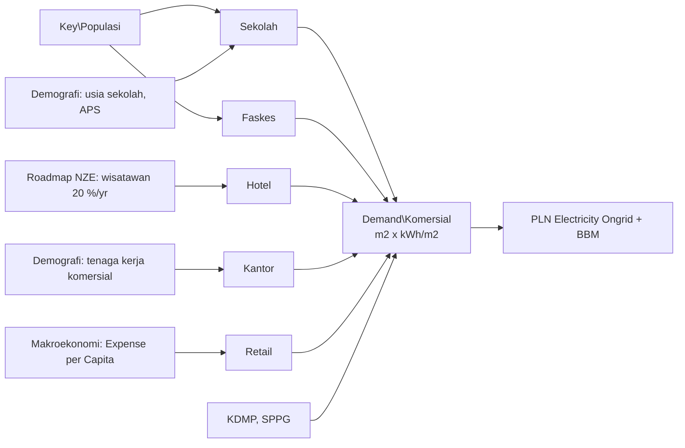

# Demand: Komersial

56 branches. Activity is **floor area (m²)** (or units for programme loads) × **Final Energy Intensity (kWh/m²/year)**. The area is built in `Key\Bangunan Komersial`.

## Structure and drivers

| Sub-sector | Branches | Activity built from (Key branch) | Intensity |
|---|---|---|---|
| **Sekolah** | TK, SD, SMP, SMA dan SMK, Perguruan Tinggi | school-age population × participation (`Key\Demografi\Angkatan Sekolah`) → students → classrooms (`Kebutuhan Kelas`) × m² per class (`Luasan Per kelas`) | `SMA dan SMK` = `Interp(2045; 40.8)`; others `GrowthAs(SMA dan SMK)` |
| **Faskes** | Puskesmas Non Ranap, Puskesmas Ranap, RS B, C, D | beds per population (`Tempat Tidur per Penduduk`) × room and bed sizes → m² | RS C = `Interp(2045; 184)`; others `GrowthAs(RS C)` |
| **Hotel** | Bintang 2/Budget, 3, 4, 5 | tourists (`Jumlah Wisatawan`, LinForecast ÷ 1000) × bed-per-annual-tourist ratio ÷ bed per room × room size × star share | 130–251 by class (2045 anchor) |
| **Kantor** | Gedung Pemerintah, Kantor NonPemerintah | commercial-sector workers (`Key\Demografi\Ketenagakerjaan\Persentase Sektor`) × m² per worker | 202 (2045 anchor) |
| **Retail** | Minimarket, Pasar Tradisional, Pusat Perbelanjaan, Toko Swalayan | `Jumlah Unit` (grows with `Expense per Capita`) × `Ukuran Unit` | Minimarket / Pasar: `Key\...\Retail\EUI`; others 315 / 335 |
| **Fasilitas Publik** | KDMP, SPPG | programme roll-out entered directly (`Interp`: KDMP 2,240 → 3,442 units 2027–2028; SPPG 139 → 600) | Peralatan Listrik, BBM shares |

## Notes

* Intensities are given as a single anchor value in 2045 (`Interp(2045; X)`); the earlier years use the same constant unless a historical series was entered.
* Electricity of Komersial is compared with PLN sales in `Indicators\Perbandingan demand listrik\Komersial RUED`. PLN customer group is *Bisnis + Layan Khusus* and *Publik + Sosial* ([calibration](../calibration.md), [known issue 2](../known-issues.md#2)).
* The tourist growth (20 %/yr) is a Roadmap NZE assumption and is the largest driver of the jump in Komersial energy in 2026 (see `Gambar 2.11`).
