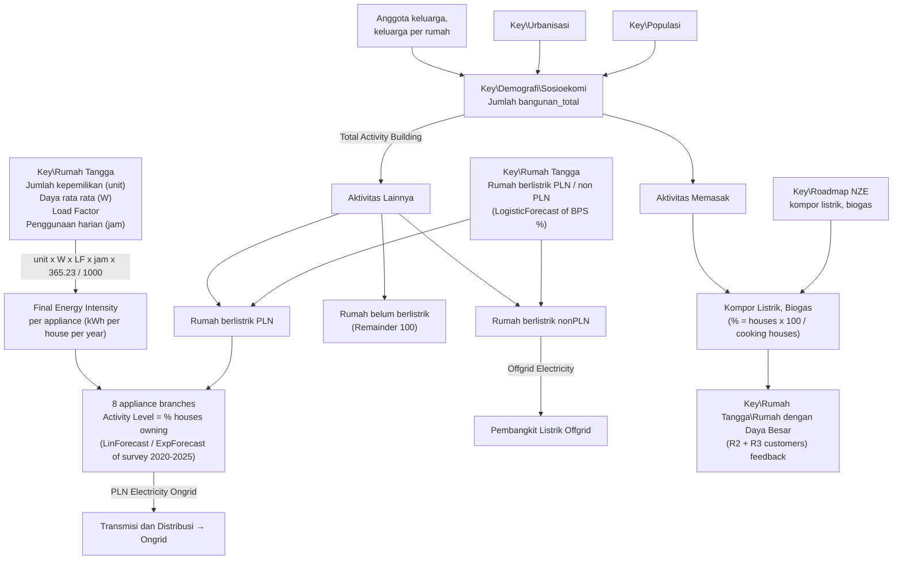

# Demand: Rumah Tangga (households)

63 branches (`Demand\Rumah Tangga`). Two activity groups: **electricity use of appliances** (split by who supplies the electricity) and **cooking**.

## Structure

```
Rumah Tangga
├── Aktivitas Lainnya                     (% of all buildings: grid access)
│   ├── Rumah berlistrik PLN              ← Key\Rumah Tangga\Rumah berlistrik PLN
│   │   ├── AC, Kipas Angin, Kulkas, Lampu, Rice Cooker, TV datar, Water Heater, Peralatan lainnya
│   ├── Rumah berlistrik nonPLN           ← Key\Rumah Tangga\Rumah berlistrik non PLN  (Remainder in Moderate/Optimis)
│   │   ├── LTSHE, Offgrid Electricity
│   └── Rumah belum berlistrik
│       └── Lampu Minyak Tanah
└── Aktivitas Memasak                     (100 − tidak memasak)
    ├── LPG, Canister, Kerosene, Wood, Biomass, Briket, Biogas, Kompor Listrik
```

## Flow



## Where each number comes from

| Item | LEAP branch | Source in Excel |
|---|---|---|
| Houses with PLN / non-PLN / no electricity (%) | `Key\Rumah Tangga\Rumah berlistrik PLN`, `...non PLN` | sheet `Rumah Tangga`, rows *Akses listrik* (2020–2024: 74.05 → 89.00 % PLN) |
| Cooking-fuel shares (LPG, kerosene, wood, electric stove …) | `Demand\Rumah Tangga\Aktivitas Memasak\*` (`Interp` blocks 2019–2025) | sheet `Rumah Tangga`, rows *Memasak* |
| Appliance ownership (units per house) | `Key\Rumah Tangga\Jumlah kepemilikan\*` (e.g. AC 1.15) | sheet `Rumah Tangga` |
| Appliance penetration (% of PLN houses) | `Activity Level` of each appliance (`LinForecast`, `ExpForecast`) | sheet `Rumah Tangga` |
| Power, load factor, daily hours | `Key\Rumah Tangga\Daya rata rata`, `Load Factor`, `Penggunaan harian` | sheet `Rumah Tangga` |
| Houses per population | `Key\Demografi\Sosioekomi\*` | sheet `Asumsi Dasar` |

## What the scenarios change here

| Building block | Change |
|---|---|
| `REOFFM` / `REOFFO` (off-grid) | `Rumah belum berlistrik` → 0 in 2035 / 2030; `nonPLN` = `Remainder(100)`; `LTSHE` share frozen at 2023 (the rest of non-PLN is `Offgrid Electricity`). `REOFFO` also raises `Key\Rumah Tangga\Rumah berlistrik PLN` (`LogisticForecast`) |
| `RELTSHEM` / `RELTSHEO` | no-access houses → 0 in 2032 / 2029; the gap is filled by `LTSHE` (`Remainder`), `Offgrid Electricity` frozen at 2023 |
| `REPLNM` / `REPLNO` | no-access houses → 0 in 2032 / 2029; the gap is filled by PLN houses (`Rumah berlistrik PLN` = `Remainder`) |
| `LPG` | cooking: `LPG` = `Remainder(100)`, `Kerosene` → 0 by 2060, `Wood` frozen at its 2023 share |
| `KON` | as `LPG` plus `Kompor Listrik` target 5,058.6 → 147,100 houses (2024 → 2060) |
| `BIOGAS` | no exported expression differs from Baseline (check the scenario in LEAP) |
| Optimis `OPT` | in the Optimis scenario itself, `Rumah berlistrik PLN` uses a higher `LogisticForecast` (91.87 % in 2025 …) and `Rumah belum berlistrik` → 0 by 2030 |

## Update checklist (each year)

1. Add the new year to `Akses listrik` and `Memasak` series (`Interp` / `LogisticForecast`) – see [data-update.md](../data-update.md).
2. Re-check `Jumlah bangunan pedesaan` (see [known issues](../known-issues.md#1)).
3. Compare electricity of Rumah Tangga with PLN sales (Indicators `Rumah Tangga RUED` vs `Rumah Tangga PLN`).
