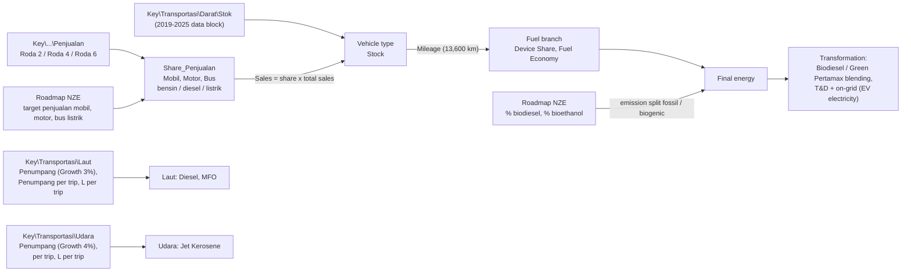

# Demand: Transportasi

167 branches (most are emission factors). Three modes: **Darat** (road, vehicle stock-turnover), **Laut** (sea) and **Udara** (air).

## Structure

```
Transportasi
├── Darat
│   ├── Mobil:        Mobil Bensin (Pertalite, Pertamax, Green Pertamax) · Mobil Diesel (Diesel, Biodiesel) · Mobil Listrik (PLN Electricity Ongrid)
│   ├── Sepeda Motor: Motor Bensin (Pertalite, Pertamax, Green Pertamax) · Motor Listrik
│   ├── Bus:          Bus Diesel (Diesel, Biodiesel) · Bus Listrik
│   └── Truk:         Truk (Diesel, Biodiesel, Pertalite, Pertamax, Green Pertamax)
├── Laut:  Diesel, MFO          Activity = passengers ÷ passengers per trip
└── Udara: Jet Kerosene         Activity = passengers ÷ passengers per trip
```

## Flow



## Notes for the modeller

* Sales split: `Mobil Bensin` is the `Remainder(1)`; `Mobil Diesel` = `1 − 0.815114`; `Mobil Listrik` = EV target ÷ total sales (`Roadmap NZE`). Total sales `Roda 2/4/6` are `LinForecast` of the data block; `Bus` and `Truk` grow as `Roda 6`.
* Fuel mix in petrol vehicles (`Device Share` Pertalite / Pertamax) uses `100 × Interp(2021; 0.89; 2022; 0.91; 2023; 0.92)` (share of Pertalite).
* The biodiesel / bioethanol *carbon* is split into fossil and biogenic CO2 with the blend % from `Roadmap NZE`.
* Sea and air fuel per trip comes from `Konsumsi bahan bakar per trip`; air passengers 2019–2025 are in sheet `Transportasi` (*Penumpang Pesawat*).

## Scenario levers

| Building block | Change in this sector |
|---|---|
| `KLKOTA` (Moderate) | e-car sales rise from 40 (2023) to 62 in 2025 and +22 per year; e-motorcycle target 551 per year by 2035 |
| `KLKOTAIS` (Optimis) | same e-car path; e-motorcycle target 30,000 per year by 2035 |
| `PTMX`, `GPTMX`, `GPTMXKEN` | from 2026 Pertalite share × 5/7 (Pertalite-free days); remainder moves to Pertamax / Green Pertamax. The exported expressions of the three are identical; the Green Pertamax effect is carried by the bioethanol branches |
| `BIODSL` (Moderate) | biodiesel blend stays at 35 % (B35) after 2024 |
| `BIODSLKN` (Optimis) | B35 in 2024 rising to 40 % in 2035 |
| `BUS` | public bus scenario (no change in the exported expressions: check in LEAP) |

Baseline: B40 from 2025 (`Step(…; 2025; 40)`).
