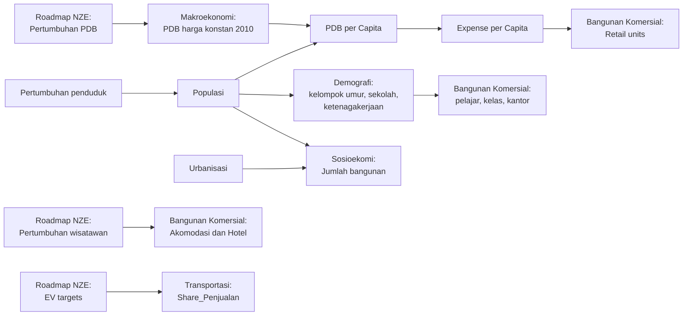

# Key Assumptions

The input tree. It holds the **data blocks 2019–2025** typed from the Excel files and the **projection expressions** that extend them to 2038. Everything in Demand and the policy parts of Transformation read from here.

388 branches. Source files: [`variables_current_accounts.csv`](../../data/structure/variables_current_accounts.csv) (calibration), [`variables_baseline.csv`](../../data/structure/variables_baseline.csv) (BaU), yearly values in [`key_assumptions_yearly.csv`](../../data/keyassumptions/key_assumptions_yearly.csv).

## 1. Sub-trees

| Sub-tree | Branches | Data blocks (series) | Constants | Derived (reads other branches) | Source sheet (Excel) | Feeds |
|---|---:|---:|---:|---:|---|---|
| `Demografi` | 132 | 77 | 16 | 39 | `Asumsi Dasar` | Populasi-based drivers: households, school-age, labour force → Komersial, Rumah Tangga |
| `Bangunan Komersial` | 134 | 21 | 84 | 29 | `Komersil` | Demand \ Komersial (floor area) |
| `Makroekonomi` | 37 | 28 | 6 | 3 | `Asumsi Dasar`, `Industry` | Demand \ Industri (GDP of sub-sectors), Expense per capita |
| `Rumah Tangga` | 35 | 4 | 30 | 1 | `Rumah Tangga` | Demand \ Rumah Tangga (ownership, power, hours, load factor, electrification) |
| `Transportasi` | 23 | 19 | 1 | 3 | `Transportasi` | Demand \ Transportasi (stock, sales, shares, sea/air) |
| `Roadmap NZE` | 24 | 11 | 12 | 1 | policy targets | Demand, Transformation, Key |
| `Populasi`, `Pertumbuhan penduduk`, `Urbanisasi` | 1 each | 3 | – | – | `Asumsi Dasar` | everything per capita |

"Series" means the expression is a function of years (`Interp`, `Step`, `Growth`, `LogisticForecast`, `LinForecast` …). The classification is a rough one made by the export script and is meant as orientation only.

## 2. How a Key Assumption is built

A Key Assumption has a single variable, *Activity Level*, whose **unit** carries the meaning (`Thousand Penduduk`, `% total bangunan`, `kendaraan`, `W` …). Five patterns occur:

| Pattern | Example | Meaning |
|---|---|---|
| **Data block** | `Key\Urbanisasi` = `Interp(2019; 7.97; 2020; 8.31; … 2025; 8.41)` | Observed values 2019–2025, linear between points, last value held after 2025 |
| **Projection from last data** | `Key\Populasi` = `Growth(Pertumbuhan penduduk[% Pertumbuhan Penduduk])`, with `Key\Pertumbuhan penduduk` = `Interp(2024; 0.0153; … )` (RPJMD projection) | Anchor year from Current Accounts, then yearly growth |
| **Derived** | `Key\Demografi\Sosioekomi\Jumlah bangunan perkotaan` = `Key\Populasi × Urbanisasi ÷ Anggota keluarga ÷ Keluarga per rumah` | Calculated from other Key branches |
| **Constant** | `Key\Rumah Tangga\Daya rata rata\AC` = `500` (W) | Engineering parameter, same every year |
| **Policy target** | `Key\Roadmap NZE\…\Persentase biodiesel pada solar` = `Step(2019; 20; 2020; 30; 2023; 30; 2024; 35; 2025; 40)` | Scenario lever; overridden in the building-block scenarios |

## 3. Main chains

The `Demografi` sub-tree is the largest by branch count: single-year age groups (`Umur 0 sd 4 … 75+`), school-age ranges, school participation rates (`APS`), labour-force status by age (`Bekerja`, `Pengangguran`, `Bukan Angkatan Kerja`). It exists to give Komersial its drivers (students, workers) and nothing else uses most of it.

## 4. Roadmap NZE (policy levers)

| Group | Branch (unit) | BaU expression (summary) |
|---|---|---|
| Asumsi sosio dan ekonomi | `Pertumbuhan PDB` (% per year) | average of 4.38, 3.95, 5.13 → 4.49 % |
| | `Pertumbuhan wisatawan` (% per year) | 20 |
| Target emisi dan bauran ketenagalistrikan | `Target bauran EBT pada ketenagalistrikan`, `Target penurunan emisi pada tahun 2035` | reference only (19 % in 2030; 0) |
| Target penjualan kendaraan rendah karbon | `mobil / motor / bus listrik per tahun` (vehicles) | 40 / 67 / 0 in 2023, held flat |
| Target penggunaan peralatan memasak rendah karbon | `Target pengguna kompor listrik`, `Target pengguna biogas rumah tangga` (houses) | electric-stove share 2019–2025 (0.56 … 0.6 %) × cooking households; biogas 10 → 30 |
| Target penggunaan biomassa dan campuran biodiesel | `Persentase biodiesel pada solar`, `Target persentase bioethanol pada green pertamax`, `Target persentase cofiring biomass`, `Target persentase biomass pada industri semen` | B20 → B30 → B35 → B40 (2025); bioethanol 5 % |
| Target penggunaan BBM ramah lingkungan | `Target penjualan Green Pertamax` (kL) | 0 |
| Target kapasitas PLTS | `atap ongrid`, `atap offgrid`, `ongrid skala utilitas`, `offgrid skala komunitas`, `produksi hidrogen`, `cofiring hydrogen pada PLTMG` (MW or %) | rooftop on-grid 9.7 MW from 2026; off-grid and utility series 2021–2025 |
| Pembatalan PLTU | `Alor`, `Atambua`, `Rote`, `Timor` (True / False) | all `False` in BaU; `Alor` and `Atambua` = `True` in Optimis |

The full list with every expression is in `variables_baseline.csv` (filter `sector = Roadmap NZE`). Scenario changes: [scenarios.md](../scenarios.md).

## 5. Where the data comes from

| Key sub-tree | Excel sheet | Examples of sources named in the workbook |
|---|---|---|
| Populasi, Demografi | `Asumsi Dasar` | BPS population (2019–2025 in thousand), RPJMD growth projection, age structure, school-age and labour tables |
| Rumah Tangga | `Rumah Tangga` | BPS *Statistik Kesejahteraan Rakyat* (access to electricity, cooking fuel; the URL is in the sheet); appliance parameters |
| Transportasi | `Transportasi` | motor-vehicle stock, estimated sales, ownership ratios, air and sea passengers (sources noted in the sheet) |
| Bangunan Komersial | `Komersil` | school-age population, school facilities and classrooms needed, hotels and tourists, retail units |
| Makroekonomi | `Asumsi Dasar`, `Industry` | PDRB by sector and industry sub-sector |

Full provenance of the report tables is in [`data/results/leap_result/data_sources.csv`](../../data/results/leap_result/data_sources.csv). The year-by-year update procedure is in [data-update.md](../data-update.md).
